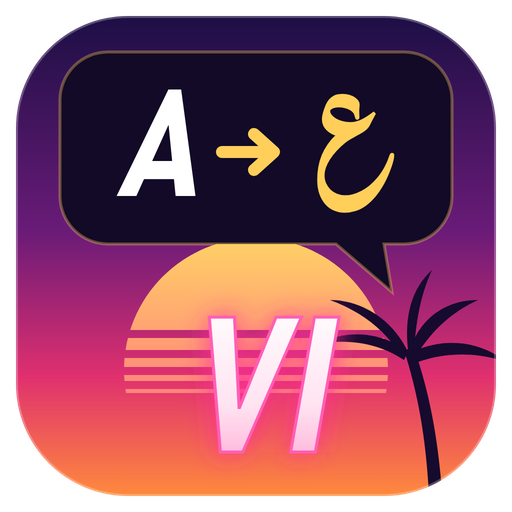

<p align="center">
  
</p>

<h1 align="center">GTA 6 Translator</h1>

<p align="center">Live subtitles in your language for GTA games, read straight from the screen.</p>

---

## What it does

- Reads the game's **subtitles and instructions** and shows them translated, in an overlay or in OBS.
- Translates **game pages** too: Mission Failed, the pause menu, alerts and on-screen captions.
- Works with a **game window**, a **capture card**, or an **OBS source**. It never touches the game.
- Keeps highlighted words in their **colours** and button **icons** in place.

GTA V is supported today. GTA VI support is planned for its release.

## Languages

- **Translation:** Arabic, Hindi, Bengali, Urdu, Indonesian, Turkish, Vietnamese, Persian, Thai,
  Tamil, Telugu, Marathi, Ukrainian, Dutch, Filipino, Malay, Swahili, Romanian, Greek, Czech.
- **Translators:** free offline model (some languages), DeepL, Azure, Google, LibreTranslate or Claude.
- **App interface:** 33 languages, including right-to-left layouts.

## Getting started

1. Run the app.
2. **Source** tab: pick the game window, capture card or OBS source.
3. **Translator** tab: pick your language and a translation service.
4. **Game profile** tab: choose *Grand Theft Auto V* and press *Use GTA V read areas*.

## Privacy

*Help improve translations* (Advanced tab) is **on by default**. Every few minutes it sends the
English lines you saw (subtitles, instructions, captions) to the project server, so they can be
translated better for everyone. It's anonymous: a random install ID, no account, no screenshots,
and never menus (that's where player names appear). Turn it off and nothing more is sent.

## Build

Needs Rust (MSVC) and the Visual Studio C++ build tools on Windows 10/11.

```powershell
cd src-tauri
cargo run                  # run (debug)
cargo build --release      # target\release\gta6-translator.exe
cargo tauri build          # installer (needs: cargo install tauri-cli --version "^2")
```

## Credits

- Included fonts (Lalezar, Changa, Cairo, Tajawal, Noto Sans Arabic) are under the SIL Open Font License.
- The offline translator uses OPUS-MT models by Helsinki-NLP (ONNX exports by Xenova).

---

<sub>GTA 6 Translator is an unofficial fan project, not affiliated with or endorsed by Rockstar Games
or Take-Two Interactive. "Grand Theft Auto" and "GTA" are trademarks of Take-Two Interactive Software, Inc.</sub>
